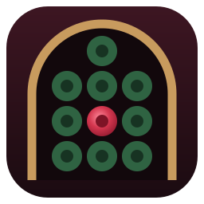
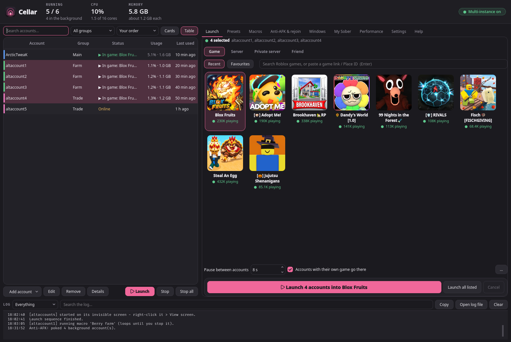

<div align="center">



# Cellar

**Run many Roblox accounts at once on Linux - each on its own invisible screen if you want.**

[][releases]
[](LICENSE)
[](#install)
[](https://sober.vinegarhq.org)
[][discord]

[**Install**](#install) · [**Features**](#features) · [**Discord**][discord] · [**Documentation**](#documentation) · [**FAQ**](#faq)



</div>

---

Cellar is an account manager and multi-instance launcher for Roblox on Linux, built on
[Sober](https://sober.vinegarhq.org). Add your accounts once, launch as many as you want at the same time, and let
them farm in the background while you keep using your PC.

Made for **grinding and farming on alts, trading, holding items, AFK-ing in private servers** - or just keeping
all your accounts in one place and launching them with one click.

**Free and open source (GPL-3.0). No ads, no account, no paywalls** - and the full source is right here, so you
can check exactly what it does.

## Features

### 🚀 Run many accounts
- **Many Sobers at once** - Sober normally allows one copy per PC; Cellar gives every account its own isolated
  one, and your normal Sober keeps working next to them.
- **Background mode** - an account runs on its own invisible screen with its own mouse and keyboard. Nothing
  shows on your desktop, nothing steals your focus. *View screen* to watch it or take over.
- **Cheap alts** - 30 FPS and the lowest graphics by default: about **0.17 CPU cores and 1 GB RAM** per alt.
  Your main keeps full quality. **Freeze** pauses an alt at 0% CPU while it stays in the server.
- **Screen wall** - live pictures of every background account in one window.

### 🎮 Launch in two clicks
- **Your games** as tiles - recent games and your favourites. Click one, press the launch button; it says exactly
  what will happen (*"Launch 4 accounts into Blox Fruits"*).
- **Servers, private servers, friends** - Quick join picks the emptiest server or a busy one with room for
  everyone; saved private servers; follow a friend from a list of who is online.
- **The website's Play button opens Cellar** - pick which accounts join that game, server or private server.
- **Bring accounts to its server** - your alts join the exact server your main is in.

### 🤖 Automate
- **Macros per account** - plain text or recorded, with `repeat` / `random` blocks and a **step-by-step** mode.
  One account farms while another does something else, and your own mouse stays yours.
- **Kicks noticed in seconds** from Roblox's own log, with an automatic rejoin (the same server after a lost
  connection), and **anti-AFK**.
- **Presets and schedules** - save a whole setup and start it in one click, or every evening at 18:00.
- **Discord alerts** - kicks, crashes and finished launches; a kicked background account comes with a picture of
  its screen, showing Roblox's own message.

### 👤 Accounts
- **Account switcher** - log your normal Sober into any account with one right-click.
- **Colour tags, groups, pins**, drag to reorder, bulk edit; **history** of what each account played and for how long.
- **Move PCs** with a password-protected export / import; **auto-lock** (with a password) hides your accounts
  after a while in the background.

### 🛠️ Your normal Sober - even with one account
- **My Sober** - Sober's settings in plain words, FPS cap, and a **Fast Flags** editor that shows which flags
  Roblox really uses.
- **Roblox logs** - what happened in a session (joined, disconnected and why) with *copy for a bug report*
  (cookies removed). Repair tools for caches and crash dumps.

### 🔒 Open and safe
- **Your accounts stay on your PC**, encrypted with your keyring or your own password, with automatic backups.
- **Nothing is uploaded anywhere.** Cellar talks to Roblox - plus GitHub for the update check (can be turned
  off) and your own Discord webhook if you add one.
- **Open source** - every line is in this repo.

### ✨ And more
Window layouts on **KDE Plasma, Hyprland and Sway** (saved layouts, all monitors) · mute alts or set a volume per
account · CPU / memory per account and graphs of the last hour · **Ctrl+K** command palette · a
[command line](#command-line-and-shortcuts) · 7 themes and your own accent colour · a first-run setup that tells
you exactly what to install.

## Install

**1. Packages** - copy the line for your distro:

| Distro | Command |
|---|---|
| Arch, CachyOS, EndeavourOS, Manjaro | `sudo pacman -S --needed flatpak passt sway wayvnc python libxkbfile xcb-util-cursor` |
| Fedora | `sudo dnf install flatpak passt sway wayvnc python3 libxkbfile xcb-util-cursor` |
| Ubuntu 24.04+, Debian 13+, Mint 22+, Pop!_OS | `sudo apt install flatpak passt sway wayvnc python3-venv libxkbfile1 libxcb-cursor0` |
| openSUSE Tumbleweed | `sudo zypper install flatpak passt sway wayvnc python3 libxkbfile1 libxcb-cursor0` |
| NixOS | see [NixOS](#nixos) below |

**2. Sober** - install it, start it once and log in:

```sh
flatpak remote-add --if-not-exists flathub https://dl.flathub.org/repo/flathub.flatpakrepo   # once, if Flathub isn't set up
flatpak install flathub org.vinegarhq.Sober
```

**3. Cellar:**

```sh
git clone https://github.com/ArcticTweaK/Cellar.git
cd Cellar
./install.sh
```

That's it - start **Cellar** from your app menu (or run `cellar`). The first start checks your system and tells
you if anything is still missing. No sudo: Cellar installs for your user only.

| | |
|---|---|
| **Update** | `git pull && ./install.sh` - Cellar tells you when a new version is out |
| **Remove** | `./uninstall.sh` (your accounts stay) |

<details>
<summary><b>What each package is for</b></summary>

`passt` (pasta) and `util-linux` (unshare) run several accounts at once, `sway` + `wayvnc` run background mode,
`flatpak` runs Sober, and the two small libraries are for Qt (most desktops already have them). Window layouts
need KDE Plasma, Hyprland or Sway; everything else works on any desktop.
</details>

### NixOS

Try it without installing:

```sh
nix run github:ArcticTweaK/Cellar
```

Or add the flake to your config:

```nix
# flake.nix
inputs.cellar.url = "github:ArcticTweaK/Cellar";
inputs.cellar.inputs.nixpkgs.follows = "nixpkgs";

# configuration.nix
environment.systemPackages = [ inputs.cellar.packages.x86_64-linux.default ];
services.flatpak.enable = true;   # then: flatpak install flathub org.vinegarhq.Sober
```

The package brings its own pasta, unshare, sway and wayvnc. Anti-AFK for normal windows also wants
`programs.ydotool.enable = true;`.

## Community and support

<table>
<tr>
<td width="50%" valign="top">

### 💬 Discord
Questions, macros, setups and announcements -
**[join the Cellar server][discord]**.

</td>
<td width="50%" valign="top">

### 🐛 Found a bug?
In Cellar: **Settings > System check > Copy report** (your cookies are removed), then
[open an issue][issues] and paste it.

</td>
</tr>
</table>

## Documentation

<details>
<summary><b>Background mode and macros</b></summary>

Linux desktops (Wayland) never let one program type into another program's window, so a normal Roblox window
only gets input while you have it focused. **Run in the background** (Edit account) gives the account its own
invisible 1280×720 screen instead: a headless `sway` that only its Sober draws on, shared over a private
`wayvnc` socket. Right-click the account > **View screen** to watch it, control it, or **record a macro** - the
mouse position you see there is what `move` / `click` use.

Macros (Macros tab) are one step per line:

```
# park the cursor on the bush and press F about 30 times a second
move 561 355
key f 15
wait 18
```

| Step | Does |
|---|---|
| `tap space` | press and release a key |
| `down w` / `up w` | hold / release a key |
| `key w 800` | hold a key for 800 ms |
| `type hello` | type text |
| `click 640 360` / `rclick x y` / `move x y` | mouse on the account's own screen |
| `scroll up` / `scroll down` | mouse wheel |
| `wait 1500` / `wait 1000-3000` | wait (a range picks a random time) |
| `repeat 5 {` … `}` | do the lines inside five times (blocks can be nested) |
| `random {` … `}` | each time, do one of the lines inside, picked at random |
| `stop after 30m` | end the macro after that long (`90s`, `2h` work too) |
| `# ...` | comment |

The editor colours the steps and underlines mistakes while you type. **Run once (test)** runs what is in the
editor once without saving it; **Step by step** runs it one line at a time with the line highlighted. A looping
macro needs at least one `wait` or `key` step. Each background account runs its own macro, and one can start by
itself at launch (Edit account > Macro at launch).
</details>

<details>
<summary><b>Command line and shortcuts</b></summary>

<a id="command-line-and-shortcuts"></a>
Control the running Cellar from a terminal, a script or a keyboard shortcut of your desktop:

```sh
cellar list                                  # accounts and what they are doing
cellar launch ArcticTweaK alt2               # each in its own game (or the one chosen on the Launch tab)
cellar launch group:Farm --place 920587237   # a whole group into one game
cellar launch all --job PLACE JOB_ID         # everyone into one exact server
cellar preset "Evening farm"                 # run a saved preset
cellar stop all
```

`launch` and `preset` start Cellar first if it is not running. Right-click an account (or a preset) >
**Add to app menu** makes a launcher entry for it.

| Key | Does |
|---|---|
| **Ctrl+K** | command palette - type a few letters of an account, tool, preset, game or theme |
| **Enter** | launch the selected accounts |
| **F2** / **Ctrl+N** | edit / add an account |
| **Ctrl+Shift+S** | stop all |
| **Ctrl+1 … 9** | switch tabs |
| **Ctrl+F** / **F5** | search accounts / refresh their status |
| **Ctrl+L** | lock (password mode) |
</details>

<details>
<summary><b>Measured numbers</b></summary>

i5-12600K, RTX 3070 Ti, 32 GB RAM, one alt standing in a game:

| Setting | CPU | RAM | Graphics memory |
|---|---|---|---|
| 240 FPS, Roblox default graphics | 0.82 cores | 1.0 GB | 245 MB |
| 30 FPS, lowest graphics (alt default) | 0.17 cores | 1.0 GB | 261 MB OpenGL / 400 MB Vulkan |
| + background mode | +0.11 cores | +0.19 GB | - |

RAM sets the limit: about 18-20 alts fit next to a desktop and browser on 32 GB. A join takes 5-10 seconds.
</details>

<details>
<summary><b>How it works</b></summary>

Sober allows one copy per PC because every copy claims the same localhost port. Cellar runs each account in its
own little sandbox:

| Per account | How |
|---|---|
| Sober profile (login, settings) | Its own `HOME` in `~/.local/share/cellar/profiles/<id>`, a copy-on-write clone of your Sober profile (about 0 bytes extra on btrfs/xfs). Cookies and logs are not copied. |
| Network | Its own network namespace (`unshare --net`) with `pasta` attached for normal internet. pasta is attached *afterwards* on purpose: if pasta starts Sober itself, it also gets a new PID namespace, the desktop portal refuses it, and Roblox waits about 2 minutes before connecting and often fails with error 279. |
| Clock, IPC | `unshare --time --ipc` |
| Runtime folder | A private `XDG_RUNTIME_DIR` with links to the real Wayland, PipeWire and D-Bus sockets |
| Process tree | A systemd user scope (`cellar-….scope`), used to stop it and for its CPU weight and RAM limit |

Every client starts with a `roblox-player:` link containing the account's own `browsertrackerid`. That number
is how Cellar matches windows and processes back to accounts, also after Cellar restarts.

The Sober developers don't support multi-instancing, so a Sober update can break it. If that happens, turn
multi-instance off (Settings) to launch accounts one at a time through your normal Sober.
</details>

<details>
<summary><b>Where Cellar keeps its files</b></summary>

| What | Where |
|---|---|
| Settings, presets, macros, history | `~/.config/cellar/settings.json` |
| Accounts (encrypted) + backups | `~/.local/share/cellar/accounts.dat`, `backups/` |
| Per-account Sober profiles | `~/.local/share/cellar/profiles/<account id>/` |
| Log | `~/.local/share/cellar/log.txt` |
| The program itself | `~/.local/share/cellar-app/` |
</details>

## FAQ

<details>
<summary><b>Is it free?</b></summary>

Yes. Free and open source under GPL-3.0 - no ads, no account, no paywalls. Join the [Discord][discord] if you
want to support it or help out.
</details>

<details>
<summary><b>Are my accounts and passwords safe?</b></summary>

They are encrypted (your keyring, or your own password) and stored only on your PC, in
`~/.local/share/cellar/accounts.dat`. Cellar never sends them anywhere except to Roblox itself to log in. With a
password you can also make Cellar lock itself after a while in the background.
</details>

<details>
<summary><b>Can my accounts get banned?</b></summary>

Running several Roblox clients and automating input is against Roblox's rules and **can get accounts
moderated**. Use accounts you can afford to lose, and give every account a verified email and 2-step
verification. A cookie is a login: never share it or your `accounts.dat`.
</details>

<details>
<summary><b>Is it useful with only one account?</b></summary>

Yes: My Sober (Sober's settings, FPS cap, Fast Flags), the Roblox logs window, the account switcher for your
normal Sober, and the website's Play button all work with one account.
</details>

<details>
<summary><b>Does it work on GNOME / other desktops?</b></summary>

Everything except window layouts and anti-AFK for normal windows works on any desktop. Those two need KDE Plasma,
Hyprland or Sway, because on Wayland only the desktop itself may move windows. Background accounts get anti-AFK
everywhere.
</details>

<details>
<summary><b>A Sober update broke something - what now?</b></summary>

Turn multi-instance off in Settings to launch accounts one at a time through your normal Sober, then tell us on
[Discord][discord] or in an [issue][issues].
</details>

## Credits and license

Made by **ArcticTweaK**. Cellar started as a Linux port of [Roblox MultiHub](https://github.com/Roblox-MultiHub/Roblox-MultiHub)
(Windows, GPL-3.0) by the Roblox-MultiHub authors, and has since been rewritten for Linux and Sober with background
mode, macros, automation and the multi-instance sandbox.

Licensed under **GPL-3.0**: free to use, change and share, as long as what you share stays open source under the
same license. Cellar is not affiliated with Roblox Corporation or VinegarHQ (Sober).

[discord]: https://discord.gg/GyTB3wsnPK
[releases]: https://github.com/ArcticTweaK/Cellar/releases
[issues]: https://github.com/ArcticTweaK/Cellar/issues
